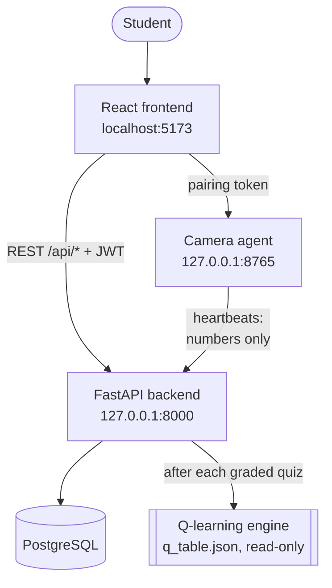

# Aegis — Adaptive Learning System

## Project Overview

Aegis is a learning platform built as a final-year B.Tech project. Instead
of giving every student the same fixed path, it grades each quiz on the
server, combines the result with attention estimates from a camera agent on
the student's computer, and recommends a personalised next step. The agent
sends only numbers and yes/no signals, never images.

## Key Features

- **Curriculum:** 122 lessons for Grades 6–10 in Mathematics, Science,
  Social Science and English, with Easy, Medium and Hard quizzes.
- **Server-side grading** with hints and an answer review after submission.
- **Q-learning recommendations:** one of 11 next steps, chosen by an
  offline-trained, read-only Q-table when the quiz has valid camera data.
- **Webcam monitoring** (with consent): attention, yawning, looking away,
  possible drowsiness and spoken alerts.
- **Protected quizzes:** server-enforced tab-switch rule, reload handling,
  autosave and a multiple-face notice.
- **Insights:** dashboard, progress analytics, AI Coach and Session Activity.

## Tech Stack

| Layer | Technologies |
|---|---|
| Frontend | React 19, Vite 8, Tailwind CSS 4, React Router 7, Axios, Recharts |
| Backend | Python 3.10, FastAPI, Uvicorn, SQLAlchemy 2, Pydantic 2, Alembic, JWT, bcrypt |
| Database | PostgreSQL (tested with 18) |
| Camera agent | OpenCV, MediaPipe, pyttsx3 |
| Recommendations | Tabular Q-learning in plain Python |

## System Architecture



1. The frontend calls the REST API through Vite's `/api` proxy with a JWT.
2. For each lesson, the camera agent pairs with a one-time token from the
   browser and sends heartbeats about once per second; lessons and quizzes
   unlock only while the camera is verified.
3. During quizzes, answers are autosaved and the backend enforces the
   tab-switch rule from page-visibility events.
4. On submission, the backend grades the answers, adds the camera averages,
   picks the next step from the Q-table and stores everything in PostgreSQL.

Details: [docs/ARCHITECTURE.md](docs/ARCHITECTURE.md),
[docs/RL_ENGINE.md](docs/RL_ENGINE.md),
[docs/SESSION_INTEGRITY.md](docs/SESSION_INTEGRITY.md).

## Project Structure

```text
Adaptive_learning_system/
├── backend/
│   ├── app/               FastAPI app: routers/, services/, models/, schemas/, auth/
│   ├── migrations/        Alembic schema migrations
│   ├── curriculum/        lesson content (content/*.json), validator, importer
│   ├── scripts/           curriculum import, role assignment, RL outcome report
│   ├── tests/
│   ├── requirements.txt
│   └── .env.example       configuration template
├── facial_analysis/       camera agent (main.py), detectors, voice alerts, tests
├── rl_engine/             Q-learning engine imported by the backend; q_table.json
├── frontend/
│   ├── src/               pages/, components/, services/ (API clients), context/, hooks/
│   └── tests/
├── docs/                  architecture, algorithms, analytics, demo, troubleshooting
├── TEAM_GUIDE.md          team workflow and the full API contract
├── start-all.ps1          checks prerequisites and starts everything (Windows)
└── stop-all.ps1
```

## Getting Started

**Prerequisites:** Windows 10 or 11 (the scripts are Windows PowerShell;
other systems are untested), Git, Python 3.10 (camera agent: 3.10–3.12),
Node.js 20.19+, 22.13+ or 24+, PostgreSQL (tested with 18) and a webcam.

Everything runs locally, so no API keys or cloud services are needed: the
only credentials are your own PostgreSQL password and a `SECRET_KEY` you
generate.

**1. Clone the repository**

```powershell
git clone https://github.com/tejasnayak24/Adaptive_learning_system.git
cd Adaptive_learning_system
```

**2. Create an empty database** in pgAdmin, or:

```powershell
& "C:\Program Files\PostgreSQL\18\bin\createdb.exe" -U postgres aegis_db
```

**3. Set up the backend**

```powershell
cd backend
python -m venv venv
.\venv\Scripts\python.exe -m pip install -r requirements.txt python-multipart==0.0.32
Copy-Item .env.example .env
.\venv\Scripts\python.exe -c "import secrets; print(secrets.token_urlsafe(48))"
notepad .env
```

`python-multipart` (needed by the login form) is missing from
`backend/requirements.txt`, so it is installed explicitly. Ignore the
outdated root `requirements.txt`.

In `backend/.env`, set `DATABASE_URL` (e.g.
`postgresql://postgres:<your-password>@localhost:5432/aegis_db`) and
`SECRET_KEY` (the printed value). The other variables already have working
values; see [backend/.env.example](backend/.env.example). Never commit
`.env`.

Create the schema and load the curriculum (both safe to re-run):

```powershell
.\venv\Scripts\python.exe -m alembic upgrade head
cd ..
backend\venv\Scripts\python.exe backend\scripts\import_curriculum.py
```

**4. Set up the camera agent**, then allow desktop apps to use the camera
(Windows Settings → Privacy & security → Camera):

```powershell
cd facial_analysis
python -m venv venv
.\venv\Scripts\python.exe -m pip install -r requirements.txt
cd ..
```

**5. Set up the frontend**

```powershell
cd frontend
npm ci
cd ..
```

**6. Run Aegis.** `start-all.ps1` checks the prerequisites and starts the
three services; it uses the `python` on `PATH`, so activate the backend
environment first:

```powershell
Set-ExecutionPolicy -Scope Process -ExecutionPolicy Bypass
.\backend\venv\Scripts\Activate.ps1
.\start-all.ps1
```

Open http://localhost:5173 (API docs: http://127.0.0.1:8000/docs); stop with
`.\stop-all.ps1`. Or run each component in its own terminal from the
project root:

```powershell
$env:PYTHONPATH = "$PWD\backend"; backend\venv\Scripts\python.exe -m uvicorn backend.app.main:app --host 127.0.0.1 --port 8000
cd facial_analysis; .\venv\Scripts\python.exe main.py
cd frontend; npm run dev
```

Then register, open a lesson, accept camera consent and take a quiz.
Troubleshooting: [docs/TROUBLESHOOTING.md](docs/TROUBLESHOOTING.md).

## Team / Contribution Notes

- Start with [docs/ARCHITECTURE.md](docs/ARCHITECTURE.md);
  [TEAM_GUIDE.md](TEAM_GUIDE.md) and the backend's `/docs` page describe
  every endpoint.
- Keep logic in `backend/app/services/`, use the `{success, message, data}`
  envelope and change the schema only through Alembic migrations.
- Grading and camera values stay server-side; missing camera data is stored
  as `NULL`, never guessed.
- Build frontend pages from `frontend/src/components/ui/`
  ([frontend/DESIGN_SYSTEM.md](frontend/DESIGN_SYSTEM.md)).
- Work on a branch, run the tests (none touch PostgreSQL) and open a pull
  request into `main`:

```powershell
cd backend; .\venv\Scripts\python.exe -m pip install -r requirements-dev.txt; .\venv\Scripts\python.exe -m pytest; cd ..
cd rl_engine; ..\backend\venv\Scripts\python.exe -m pytest; cd ..
cd facial_analysis; .\venv\Scripts\python.exe -m pip install -r requirements-dev.txt; .\venv\Scripts\python.exe -m pytest; cd ..
cd frontend; npm test; npm run lint; cd ..
```

**Team:** Tejas Nayak (team lead, reinforcement learning, integration),
Rishika Rajesh (backend), Rohan M Shet (facial analysis), Roshwin Dsouza
(frontend).
