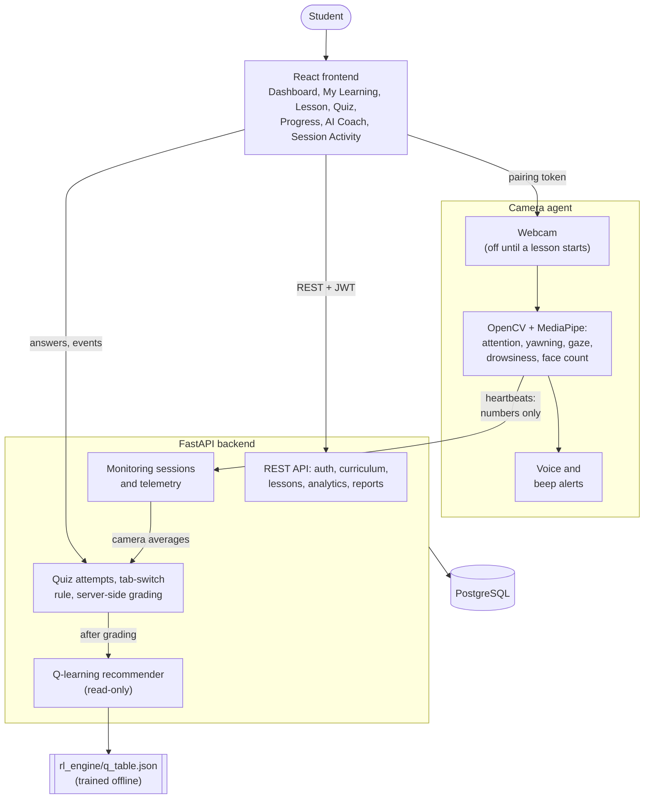
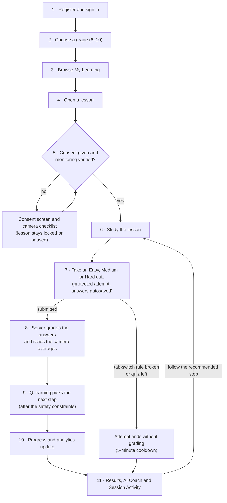
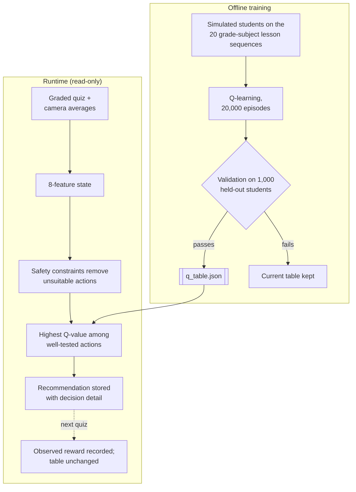
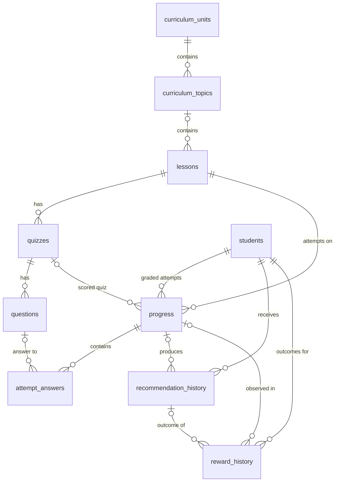
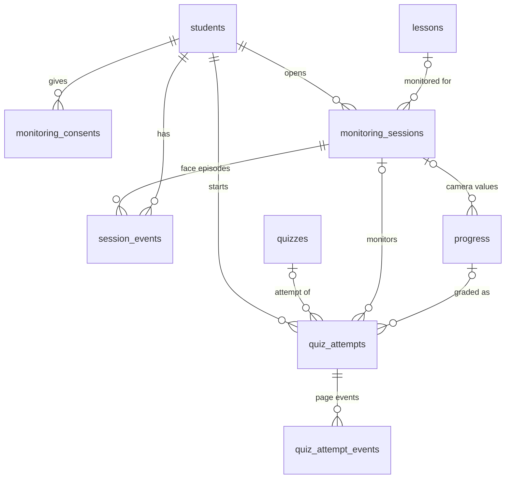

# Aegis — Adaptive Learning System

**Adaptive lessons and quizzes for Grades 6–10, guided by a Q-learning
recommendation engine and privacy-preserving webcam attention estimates.**


Aegis is a full-stack learning platform built as a final-year B.Tech
project. Students study curriculum lessons in Mathematics, Science, Social
Science and English, take Easy, Medium and Hard quizzes, and receive a
recommended next step after every graded quiz. A camera agent on the
student's own computer estimates attention and notices yawning, looking
away and possible drowsiness. Only numbers and yes/no signals leave it,
never images or video.

| | |
|---|---|
| **Repository** | https://github.com/tejasnayak24/Adaptive_learning_system |
| **Stack** | React 19 + Vite · FastAPI + SQLAlchemy · PostgreSQL · OpenCV + MediaPipe · tabular Q-learning |
| **Content** | Grades 6–10 × 4 subjects: 122 lessons, 366 quizzes, 1,479 questions |
| **Status** | Feature-complete for the final-year evaluation (November 2026). Runs locally; tested on Windows 11 |

**At a glance:** grade-based curriculum and personal dashboard · structured
lessons · server-graded quizzes with hints and answer review · Q-learning
"next step" after every quiz · webcam attention, yawning, gaze and
drowsiness estimates with voice alerts · protected quizzes (tab-switch rule,
multiple-face notice) · progress analytics, AI Coach and a transparent
Session Activity report.

## Contents

- [Overview](#overview)
- [Problem statement](#problem-statement)
- [Key features](#key-features)
- [Technology stack](#technology-stack)
- [System architecture](#system-architecture)
- [Application workflow](#application-workflow)
- [Reinforcement learning](#reinforcement-learning)
- [Computer vision and monitoring](#computer-vision-and-monitoring)
- [Quiz session integrity](#quiz-session-integrity)
- [Project structure](#project-structure)
- [Installation and setup](#installation-and-setup)
- [Environment variables](#environment-variables)
- [Database schema](#database-schema)
- [API documentation](#api-documentation)
- [Testing](#testing)
- [Privacy and security](#privacy-and-security)
- [Limitations and future work](#limitations-and-future-work)
- [Documentation](#documentation)
- [Project team and acknowledgements](#project-team-and-acknowledgements)

## Overview

Most learning software gives every student the same sequence of lessons and
the same next step, whether they scored 30% or 95%, and whether they were
alert or nodding off. Teachers cannot watch every student, and students
often do not know which topics they should revise.

Aegis personalises the **next step**. After each quiz the server grades the
answers and combines the result (score, quiz level, hints used, attempts and
recent trend) with what the camera agent observed during that quiz (average
attention, yawning, looking away, possible drowsiness). A **Q-learning
policy**, trained offline on simulated students, then chooses one of 11 next
steps: for example, study a worked example, retry with hints, try a harder
quiz, or take a short focus-recovery break. Safety rules make sure it never,
for instance, moves a student on before they have passed.

The webcam is used only to support learning. Monitoring is required during
lessons and quizzes, needs the student's consent (and guardian and school
confirmation for students under 18), and runs entirely on the student's
computer. Quizzes are protected by a server-enforced tab-switch rule, and
every student can see exactly what was recorded about them.

| Intended users | Subjects |
|---|---|
| School students in **Grades 6–10** (curriculum and quizzes are filtered by grade); teachers and admins can manage lessons through the API | Mathematics, Science, Social Science, English |

## Problem statement

Aegis was built around five problems:

1. **Fixed learning paths.** Every learner follows the same order and pace,
   regardless of how well they understood the last lesson.
2. **Limited personalisation.** Systems that adapt usually look only at the
   last score, not at how the student was learning.
3. **No feedback on engagement.** Neither the student nor the system knows
   whether the student was attentive, tired or distracted during a quiz.
4. **Unclear revision needs.** Students find it hard to tell which topics
   are strong, which need revision and which they have not started.
5. **Unreliable assessments.** Online quizzes are easy to game when answers
   reach the browser, scores are computed on the client, or leaving the
   quiz has no consequence.

Aegis addresses these within a single-student, local deployment. It does not
replace teachers, and its camera measurements are estimates, not diagnoses.

## Key features

| # | Feature | Purpose |
|---|---|---|
| 1 | **Accounts and grade-based access** | Registration and sign-in (JWT, bcrypt-hashed passwords). The student's grade (6–10) decides which curriculum they see; a lesson from another grade is refused |
| 2 | **Personal dashboard** | Greeting and grade, curriculum completion, stat cards, *Continue learning*, latest result, subject progress, AI coach card and learning streak, all from the student's own records |
| 3 | **Curriculum navigation** | *My Learning*: subject → unit → topic → lesson, with search, status filters and a "next up" lesson |
| 4 | **Structured lessons** | Objectives, explained sections, key terms, examples, step-by-step worked examples, a diagram, a real-world application, takeaways and practice questions |
| 5 | **Easy, Medium and Hard quizzes** | Three levels per lesson, a hint for every question, practice, hint and timed-challenge modes, and an answer review with explanations after submission. Grading happens on the server |
| 6 | **Q-learning recommendations** | After every graded quiz, an offline-trained Q-table chooses one of 11 next steps among the actions the safety rules allow |
| 7 | **Webcam attention estimation** | The local camera agent turns MediaPipe face landmarks into an attention estimate (0–1) about once per second |
| 8 | **Yawning, gaze and possible drowsiness** | Mouth opening, head direction, eye gaze and eye closure detect yawning, sustained looking away (2 s or more) and possible drowsiness (eyes closed for 2 s or more) |
| 9 | **Multiple-face detection** | A separate face counter shows an informational banner when more than one face stays visible for about 3 seconds, and records the episode. It never ends a quiz |
| 10 | **Voice alerts** | The agent speaks short prompts ("Hey, wake up!", "Are you still there?", a yawn reminder, a break suggestion) and beeps; speech never blocks the camera loop |
| 11 | **Protected quizzes** | A two-strike tab-switch rule decided by the server, confirmed reloads counted as incidents, autosaved answers, and a 5-minute cooldown after an ended attempt |
| 12 | **Session Activity** | A factual timeline of each attempt: tab-switch incidents with measured time away, outcomes, unverified periods and multiple-face episodes. No score or verdict |
| 13 | **Progress and analytics** | Score trend with the pass line, weekly activity, attention trend, subject averages, milestones and quiz history, with one filter row and a table view for every chart |
| 14 | **Topic-level insights** | Each topic is *Strong*, *Needs revision*, *Weak*, *Not enough attempts* or *Not started*, from its last three attempts, with *Revise* or *Continue* links |
| 15 | **AI Learning Coach** | The current advice in plain words, the quiz it is based on, its decision strength (not a probability), the history of earlier advice with outcomes, and the 11 possible actions |
| 16 | **Consent and privacy controls** | Versioned camera consent, guardian and school confirmation for students under 18, a webcam that stays off until a lesson starts, and no stored images or video |

## Technology stack

Every entry below is taken from the project's manifests
(`frontend/package.json`, `backend/requirements.txt`,
`facial_analysis/requirements.txt`) and source code.

| Layer | Technology | Version | Used for |
|---|---|---|---|
| **Frontend** | React | 19.2 | User interface (function components, hooks) |
| | Vite | 8.1 | Dev server with the `/api` proxy, production build, code splitting |
| | JavaScript (ES modules, JSX) | — | Application code |
| | Tailwind CSS | 4.3 | Styling with design tokens ([frontend/DESIGN_SYSTEM.md](frontend/DESIGN_SYSTEM.md)) |
| | React Router | 7.18 | Client-side routes |
| | Axios | 1.18 | HTTP client for the backend API |
| | Recharts | 3.10 | Progress and analytics charts |
| | Lucide React | 1.65 | Icons |
| | Inter and Outfit (`@fontsource-variable`) | 5.3 | Self-hosted fonts |
| **Backend** | Python | 3.10 | Runtime (tested version) |
| | FastAPI + Uvicorn | 0.140 / 0.51 | REST API, request validation, OpenAPI docs |
| | Pydantic | 2.13 | Request and response schemas |
| | SQLAlchemy | 2.0 | ORM and database access |
| | Alembic | 1.18 | Versioned schema migrations (`0001`–`0008`) |
| | psycopg2-binary | 2.9 | PostgreSQL driver |
| | python-jose, passlib + bcrypt | 3.5, 1.7 + 4.3 | JWT login tokens (HS256) and password hashing |
| | python-dotenv, email-validator, python-multipart | — | Configuration from `backend/.env`, e-mail validation, OAuth2 form login |
| **Database** | PostgreSQL | 18 (tested) | All persistent data; SQLite is used only by the test suites |
| **Computer vision** | OpenCV (`opencv-contrib-python`) | 4.11 | Camera capture, image handling, preview window |
| | MediaPipe | 0.10.21 | Face Mesh landmarks (eyes, mouth, head, iris) and Face Detection (face count) |
| | NumPy | 1.26.4 | Numerical work in the detectors |
| | pyttsx3 | 2.99 | Spoken alerts (Windows SAPI5) |
| | requests + Python's `http.server` | 2.34 | Agent → backend heartbeats; the agent's local HTTP endpoint for the browser |
| **Reinforcement learning** | Tabular Q-learning in pure Python | — | State encoding, 11 actions, safety constraints, student simulator, offline trainer, evaluation; the trained policy is `rl_engine/q_table.json` |
| **Development and testing** | Git and GitHub | — | Version control, pull requests |
| | pytest + httpx | 8.4 + 0.28 | Backend, RL and camera-agent tests (FastAPI `TestClient`) |
| | Node.js + npm | 20.19+ / 22.13+ / 24 (tested 24) | Frontend tooling; unit tests with Node's built-in test runner |
| | ESLint | 10 | Frontend linting |
| | Playwright + headless Chrome | — | Browser acceptance runs (see [docs/TESTING.md](docs/TESTING.md)) |
| | PowerShell | 5.1+ | `start-all.ps1` and `stop-all.ps1` |

**Why these choices**
- **FastAPI and Pydantic** validate every request against typed schemas and
  generate the interactive API documentation automatically.
- **PostgreSQL with SQLAlchemy and Alembic** gives relational integrity
  (students, lessons, attempts, recommendations), JSON columns for
  structured data such as saved answers and decision details, a partial
  unique index that allows only one open attempt per student and quiz, and
  reproducible migrations.
- **React with Vite** keeps the interface fast: pages are split into
  separate bundles and the dev server proxies the API on the same origin.
- **MediaPipe and OpenCV** run real-time face landmarks on an ordinary
  laptop CPU, so no GPU or cloud service is needed and images never leave
  the computer.
- **Tabular Q-learning** suits a small, discrete state (1,944 states): every
  decision can be explained from the stored Q-values, and the engine needs
  no machine-learning framework.

## System architecture

Aegis runs as three local services and a database, all on the student's
computer.



1. The student uses the **React frontend** (http://localhost:5173), which
   calls the **FastAPI backend** (127.0.0.1:8000) through the Vite dev
   server's `/api` proxy with a JWT bearer token.
2. Opening a lesson creates a **monitoring session**. The browser passes a
   single-use pairing token to the **camera agent** (127.0.0.1:8765), which then sends
   heartbeats (attention, yawning, looking away, possible drowsiness, face
   count) straight to the backend. **No image, video or landmark data is
   sent.**
3. During a quiz the browser reports page-visibility events and autosaves
   answers; the backend's **session-integrity** service applies the
   tab-switch rule.
4. On submission the backend **grades** the answers, averages the camera
   measurements received during the attempt, and asks the **Q-learning
   recommender** for the next step. Everything is stored in **PostgreSQL**.
5. Dashboard, Progress, AI Coach and Session Activity read the student's own
   records from the **analytics and report** endpoints.

More detail, including trust boundaries and a code map:
[docs/ARCHITECTURE.md](docs/ARCHITECTURE.md).

## Application workflow

1. The student registers and signs in.
2. They choose their grade (at registration or on first sign-in).
3. *My Learning* shows the subjects, units, topics and lessons of that grade.
4. The student opens a lesson.
5. Camera consent is checked, the agent pairs, and monitoring must be
   verified (camera on, face visible, live data) before the lesson unlocks.
6. The student studies the lesson content.
7. They start an Easy, Medium or Hard quiz, which runs as a protected
   attempt.
8. The backend grades the answers and attaches the camera averages.
9. The Q-learning engine selects the next action within the safety rules.
10. Progress and analytics are updated.
11. The student reviews the results, the AI Coach advice and their Session
    Activity, and follows the recommended next step.



## Reinforcement learning

**Q-learning** is a reinforcement-learning method that learns a table
`Q(s, a)`: the expected long-term reward of taking action `a` in state `s`.
Aegis treats each recommendation as a decision whose effect shows up in the
student's next quizzes, and learns which teaching action works best in each
situation.

> **Important:** the Q-table was trained **offline on simulated students**.
> It is **not updated during live sessions**: the backend only reads it.
> Real outcomes are recorded for evaluation and possible future offline
> retraining, but they never change the deployed policy.



**State (8 features, 1,944 states; the shipped table learned 1,571).**
Score level (< 50%, 50–79%, ≥ 80%), attention level (< 0.40, 0.40–0.59,
≥ 0.60), quiz difficulty, many hints (≥ 2), many attempts (≥ 3), fatigue
(none, yawning, possible drowsiness), sustained looking away, and score
trend on the lesson (declining, steady, improving).

**Actions (11).**

| Action | What the student gets |
|---|---|
| `NEXT_LESSON` | The next lesson |
| `REPEAT_LESSON` | The same lesson again, with study guidance |
| `INCREASE_DIFFICULTY` / `DECREASE_DIFFICULTY` | The next harder / easier quiz of the lesson |
| `PRACTICE_QUIZ` | The same quiz as a practice attempt |
| `QUICK_CHALLENGE` | The quiz as a timed challenge |
| `SHOW_WORKED_EXAMPLE` | The answer review with the correct answers |
| `PROVIDE_HINT` | The quiz again, with hints encouraged |
| `FOCUS_RECOVERY` | A 60-second guided break |
| `SHOW_REAL_WORLD_APPLICATION` | The lesson with a real-world prompt |
| `SKIP_TO_ADVANCED_TOPIC` | The lesson two steps ahead |

**Safety constraints** only remove actions; they never choose one. For
example, `NEXT_LESSON` is blocked below 50%, `INCREASE_DIFFICULTY` at HARD,
below 50% or with possible drowsiness, and `SKIP_TO_ADVANCED_TOPIC` below
90%. Six actions are never blocked, so the Q-table always chooses among at
least six candidates.

**Reward (version 2)** judges what happened after an action, using two
consecutive real or simulated attempts: learning gain (difficulty-adjusted
score change), a bonus for finishing a lesson properly and a penalty for
leaving with gaps, a frustration penalty, the change in attention, whether
possible drowsiness cleared, and a small cost per step. Missing camera
values are left out, never guessed.

**Training.** Update rule
`Q(s,a) ← Q(s,a) + α [r + γ max_a' Q(s',a') − Q(s,a)]`, with the maximum taken
only over permitted actions; α = 0.1, γ = 0.95, ε-greedy exploration from 1.0
down to 0.05; 20,000 episodes of up to 60 steps; seed 2026. Retraining is a deliberate offline step
(`python -m rl_engine.train`), and a new table replaces the old one only if it beats a random policy, is no worse than the
old rule policy, makes no safety violations and covers at least half of the
states.

**Selecting a recommendation.** The policy is **greedy and read-only**: it
encodes the state, removes blocked actions, keeps actions tried at least 5
times in training for that state, and picks the highest Q-value. Unlearned
states use the most similar learned state (one feature different), or fall
back to `REPEAT_LESSON` with zero confidence. The reported *decision
strength* is a heuristic from the Q-value margin and visit count, **not a
probability**. Without valid camera telemetry no recommendation is made.

**Offline evaluation** (1,000 held-out simulated students): mean return
−3.79 for the learned policy against −23.83 for the previous rule policy and
−29.57 for random choices; no student advanced before passing; 4.8% of steps
ended with possible drowsiness (14.9% with the rules); zero constraint
violations. These results hold inside the simulator; effectiveness on real
students has not been measured yet.

Full details: [docs/RL_ENGINE.md](docs/RL_ENGINE.md).

## Computer vision and monitoring

The camera agent (`facial_analysis/`) is a Python program that runs on the
student's computer and listens only on `127.0.0.1:8765`. The webcam stays
**off** until a monitored lesson starts, and is released when the session
ends.

| Signal | How it is estimated |
|---|---|
| Face present | MediaPipe Face Mesh finds a face in the frame |
| Eyes open / blinks | Eye aspect ratio from eye landmarks (closed below 0.23) |
| Head direction | Nose-tip offset from the face's centre: forward, left, right, up or down |
| Gaze | Iris position within the eye |
| Looking away | Head or gaze away from the screen for at least 2 seconds |
| Yawning | Mouth aspect ratio above 0.60 |
| Possible drowsiness | Eyes closed for at least 2 seconds |
| Attention (0–1) | Starts at 100 and subtracts penalties (no face 40, eyes closed 20, head turned 20, looking away 15, yawning 15, high blink rate 10), averaged over the last 30 frames |
| Face count | MediaPipe Face Detection (BlazeFace) about twice a second on a small copy of the frame; a warning needs two or more faces in 5 of the last 6 samples (about 3 s) |

**Voice alerts.** Eyes closed for 2 seconds trigger a beep and "Hey, wake
up!" (repeated every 5 seconds); no face for 10 seconds triggers "Are you
still there?"; yawns trigger a gentle reminder, and three yawns within 5
minutes suggest a break. Speech runs on its own thread.

**Privacy.**
- Raw images and video are **never stored or transmitted** by Aegis. The
  heartbeat (about once per second) contains only numbers and yes/no
  values, and the agent never sends a student id.
- The backend keeps, per quiz attempt, only the average attention and
  whether yawning, looking away or drowsiness was seen. Multiple-face
  episodes store only start and end times and the peak face count.
- Measurements that are missing or stale are stored as "unavailable"
  (`NULL`), never as low attention.

These are **estimates to support learning**. They are not a medical or
sleep assessment, and a second face or a hidden tab is never presented as
proof of misconduct. Accuracy depends on lighting, camera angle and
glasses. More detail: [facial_analysis/README.md](facial_analysis/README.md).

## Quiz session integrity

Every graded quiz runs as a **protected attempt** that the server tracks
(`quiz_attempts`). The authoritative description is
[docs/SESSION_INTEGRITY.md](docs/SESSION_INTEGRITY.md).

| Situation | Result |
|---|---|
| Quiz page hidden for the first time | A 10-second grace period starts, timed by the **server** |
| Back within 10 seconds | The quiz continues with a warning (strike 1) and a warning banner |
| Not back within 10 seconds | **Terminated** (`grace_expired`) |
| Hidden again after the warning | **Terminated immediately** (`second_tab_switch`) |
| Confirmed reload (the student accepts the browser's prompt) | Counts as a tab-switch incident; the same attempt and answers come back |
| Cancelled reload | Not an incident; nothing is reported |
| Leaving for another page (link or Back) | Asks first; confirming makes the attempt **abandoned** (not graded, not a violation) |
| Network interruption | **Never a violation.** The attempt is locked as `unverified` until a report arrives |
| Window focus changes (e.g. clicking the agent window) | Recorded for diagnostics only; never a strike |

- **Answers are preserved.** They are autosaved to the server and survive
  reloads; when an attempt ends they are kept but frozen.
- **Terminated and abandoned attempts are never graded.** They create no
  progress row, so they do not count towards completion, averages,
  analytics, recommendations or rewards. A new attempt at the same quiz is
  possible after a **5-minute cooldown**.
- **Server-side enforcement.** The browser only reports events (sent with
  `keepalive` the moment the page is hidden); the server times the grace
  period, ignores duplicate reports and decides every outcome.
- **Session Activity** (`/activity`) shows the student their own incidents,
  measured time away, outcomes, unverified periods and multiple-face
  episodes, with no score or probability.

## Project structure

```text
Adaptive_learning_system/
├── backend/                     FastAPI backend
│   ├── app/
│   │   ├── auth/                JWT creation and checks, password hashing
│   │   ├── database/            SQLAlchemy engine and sessions
│   │   ├── models/              database tables (SQLAlchemy models)
│   │   ├── routers/             HTTP endpoints
│   │   ├── schemas/             Pydantic request and response models
│   │   ├── services/            business logic (grading, attempts, monitoring, RL, analytics)
│   │   ├── utils/
│   │   └── main.py              application entry point
│   ├── curriculum/              loader, validator, importer
│   │   └── content/             20 curriculum files (g06_english.json … g10_social_science.json)
│   ├── migrations/              Alembic environment and versions 0001–0008
│   ├── scripts/                 curriculum import and checks, role assignment, RL outcome report
│   ├── tests/                   backend tests (pytest)
│   ├── seed_science.py          the five original Science lessons (used by the importer)
│   ├── alembic.ini
│   ├── .env.example             configuration template (copy to .env)
│   ├── requirements.txt
│   └── requirements-dev.txt
├── facial_analysis/             local camera agent
│   ├── main.py                  entry point
│   ├── agent_server.py          local HTTP endpoint for the browser (127.0.0.1:8765)
│   ├── monitor.py               monitoring session controller (pairing, heartbeats)
│   ├── frame_processor.py       runs the detectors on each frame
│   ├── face_detector.py, eye_tracker.py, head_pose.py, gaze_tracker.py,
│   │   yawn_detector.py, looking_away.py, drowsiness_detector.py,
│   │   face_presence.py, face_counter.py, attention_engine.py
│   ├── camera.py, backend_client.py, logger.py, attention_score.py
│   ├── voice_alert.py, hud.py   spoken alerts, preview window
│   ├── windows_privacy.py       Windows camera-privacy check
│   ├── config.py                thresholds, ports, allowed origins
│   ├── tests/                   automated tests and manual webcam checks
│   └── requirements.txt
├── rl_engine/                   Q-learning recommendation engine
│   ├── core/                    state encoding, actions, safety constraints, config
│   ├── models/                  student state and recommendation types
│   ├── training/                agent, simulator, environment, rewards, trainer
│   ├── evaluation/              baselines and evaluation
│   ├── tests/
│   ├── archive/                 previous Q-table (version 2)
│   ├── q_table.json             trained policy loaded by the backend
│   └── train.py                 offline training entry point
├── frontend/                    React + Vite single-page app
│   ├── src/
│   │   ├── pages/               Dashboard, Subjects, LessonDetail, QuizView, Progress,
│   │   │                        Recommendations, SessionActivity, Login, Register
│   │   ├── components/          monitoring gate, quiz-integrity dialogs, charts, lesson material
│   │   │   └── ui/              shared design-system components
│   │   ├── context/             authentication and monitoring state
│   │   ├── hooks/               quiz-integrity tracker, reduced motion
│   │   ├── layouts/             app shell (sidebar, top bar)
│   │   ├── services/            API, camera-agent and quiz-integrity clients
│   │   └── utils/               analytics and recommendation helpers
│   ├── tests/                   unit tests (Node test runner)
│   ├── index.html, vite.config.js, eslint.config.js
│   ├── DESIGN_SYSTEM.md
│   ├── package.json
│   └── package-lock.json
├── docs/                        technical documentation (see below)
├── start-all.ps1                checks prerequisites and starts all services (Windows)
├── stop-all.ps1                 stops them
├── .gitignore
└── README.md
```

| Directory | Purpose |
|---|---|
| `backend/` | REST API, database models and migrations, curriculum content and import, server-side grading, monitoring, session integrity, analytics |
| `facial_analysis/` | The camera agent: webcam analysis, alerts and heartbeats to the backend |
| `rl_engine/` | The Q-learning engine: training, evaluation and the trained Q-table, imported by the backend |
| `frontend/` | The student-facing web application |
| `docs/` | Architecture, API, development, testing, algorithms and acceptance checklists |

## Installation and setup

These steps set up Aegis from scratch with your **own** database. They were
verified on Windows 11 for this release with fresh virtual environments, a
fresh `npm ci` and a new, empty PostgreSQL database
([details](docs/TESTING.md#results-for-this-release-2026-11-14)).

### Prerequisites

| Requirement | Version | Notes |
|---|---|---|
| Operating system | Windows 10 or 11 | `start-all.ps1` is Windows-only; see [macOS and Linux](#macos-and-linux-manual-and-untested) |
| Git | any recent version | To clone the repository |
| Python | **3.10** (tested) | The camera agent's pinned packages need Python **3.10–3.12**; 3.13 and newer cannot be used for it. Tick "Add python.exe to PATH" when installing |
| Node.js and npm | 20.19+, 22.13+ or 24+ (tested with 24) | Required by Vite 8 and ESLint 10 |
| PostgreSQL | 18 (tested) | Earlier versions have not been tested. Remember the password you give the `postgres` user |
| Webcam | built-in or USB | Lessons and quizzes require camera monitoring. Speakers are optional (voice alerts) |

### Step 1: Clone the repository

```powershell
git clone https://github.com/tejasnayak24/Adaptive_learning_system.git
cd Adaptive_learning_system
```

Run the remaining commands from this folder (the project root) unless a
step says otherwise.

### Step 2: Create a PostgreSQL database

Every developer uses **their own, empty database**. Never point Aegis at
someone else's database. The examples use the name `aegis_db`.

- **pgAdmin:** right-click *Databases* → *Create* → *Database…*, name it
  `aegis_db`, save.
- **Command line** (PostgreSQL's tools are not on `PATH` by default):

  ```powershell
  & "C:\Program Files\PostgreSQL\18\bin\createdb.exe" -U postgres aegis_db
  ```

### Step 3: Set up the backend

```powershell
cd backend
python -m venv venv                                        # if several Pythons are installed: py -3.10 -m venv venv
.\venv\Scripts\python.exe -m pip install -r requirements.txt
Copy-Item .env.example .env
.\venv\Scripts\python.exe -c "import secrets; print(secrets.token_urlsafe(48))"
notepad .env
```

In `.env`, set:
- `DATABASE_URL` to your database, for example
  `postgresql://postgres:<your-password>@localhost:5432/aegis_db`;
- `SECRET_KEY` to the random value printed above. The backend refuses to
  start with the placeholder or a key shorter than 16 characters.

`.env` is git-ignored; never commit it. All variables are described in
[Environment variables](#environment-variables).

Create the tables and load the curriculum (both are safe to re-run):

```powershell
.\venv\Scripts\python.exe -m alembic upgrade head          # creates the schema (8 migrations)
cd ..
backend\venv\Scripts\python.exe backend\scripts\import_curriculum.py
```

After the first import the database holds 122 lessons, 366 quizzes and
1,479 questions; running it again creates nothing. To validate the content
without touching the database, add `--check`.

### Step 4: Set up the camera agent

The agent has its own virtual environment, which `start-all.ps1` expects in
`facial_analysis\venv`:

```powershell
cd facial_analysis
python -m venv venv                                        # Python 3.10–3.12, e.g. py -3.10 -m venv venv
.\venv\Scripts\python.exe -m pip install -r requirements.txt
cd ..
```

- Allow camera access: Windows **Settings → Privacy & security → Camera**,
  turn on *Camera access* and *Let desktop apps access your camera*.
- Close other apps that use the webcam (Teams, Zoom, the Camera app).
- The agent accepts requests only on `127.0.0.1:8765` and only from the
  frontend at `http://localhost:5173`, so keep that port.

### Step 5: Set up the frontend

```powershell
cd frontend
npm ci                                                     # installs exactly the locked versions
cd ..
```

### Step 6: Start Aegis

`start-all.ps1` uses the `python` on your `PATH` for the backend, so
activate the backend's virtual environment in the same PowerShell window
first:

```powershell
Set-ExecutionPolicy -Scope Process -ExecutionPolicy Bypass   # allows scripts in this window only
.\backend\venv\Scripts\Activate.ps1
.\start-all.ps1
```

The script first checks everything and stops with a hint if something is
missing: Python and npm, `backend\.env`, `frontend\node_modules`, the agent's
virtual environment, free ports 8000, 8765 and 5173, that PostgreSQL is
reachable, and that the schema is at the latest migration (it only reads;
it never changes the database). It then opens three windows and the
browser:

| Window | Service | Address |
|---|---|---|
| Aegis backend | FastAPI API | http://127.0.0.1:8000 (interactive API docs: http://127.0.0.1:8000/docs) |
| Aegis camera agent | Camera agent (webcam off until a lesson starts) | http://127.0.0.1:8765 |
| Aegis frontend | Vite dev server | **http://localhost:5173** (open this) |

Options: `-CheckOnly` (only the checks), `-NoAgent`, `-NoBrowser`,
`-WindowStyle Minimized`. Stop everything with:

```powershell
.\stop-all.ps1
```

It stops only Python or Node processes listening on the three Aegis ports
and closes the windows `start-all.ps1` opened. To run the services one by
one instead, see [docs/DEVELOPMENT.md](docs/DEVELOPMENT.md#running-the-services-one-by-one).

### Step 7: First use

1. Open http://localhost:5173 and **register**: name, e-mail, age, grade
   (6–10) and a password of 8–72 characters. Then sign in.
2. If you skipped the grade, Aegis asks for it before showing lessons.
3. Open **My Learning**, choose a subject and open a lesson.
4. **Give camera consent.** Students under 18 also confirm guardian and
   school authorisation. The webcam turns on and a checklist runs (agent →
   webcam → face → live data); the lesson unlocks when monitoring is
   verified.
5. Study the lesson, then **take a quiz** (Easy, Medium or Hard). Use
   *Need a hint?* if needed, then *Review and submit*.
6. The results show the score, an answer review with explanations, and
   **Your AI coach's next step**. Follow it, or open **AI Coach**,
   **Progress** and **Session Activity** from the sidebar.

Optional: give an account the teacher or admin role (lesson management
through the API):

```powershell
backend\venv\Scripts\python.exe backend\scripts\set_role.py teacher@example.com teacher
```

Problems? See [docs/TROUBLESHOOTING.md](docs/TROUBLESHOOTING.md).

### macOS and Linux (manual and untested)

Automatic start-up is **Windows-only**: the scripts use Windows PowerShell
cmdlets. The backend and frontend are standard Python and Node applications
and the camera agent has fallbacks for other systems (OpenCV's default
camera backend, no Windows privacy check, no beeps), but **none of this has
been tested outside Windows**. If you try it:

```bash
git clone https://github.com/tejasnayak24/Adaptive_learning_system.git
cd Adaptive_learning_system
createdb -U postgres aegis_db

python3 -m venv backend/venv                       # Python 3.10–3.12
backend/venv/bin/python -m pip install -r backend/requirements.txt
cp backend/.env.example backend/.env               # then set DATABASE_URL and SECRET_KEY
(cd backend && venv/bin/python -m alembic upgrade head)
backend/venv/bin/python backend/scripts/import_curriculum.py

python3 -m venv facial_analysis/venv
facial_analysis/venv/bin/python -m pip install -r facial_analysis/requirements.txt
(cd frontend && npm ci)

# then, in three terminals from the project root:
PYTHONPATH=backend backend/venv/bin/python -m uvicorn backend.app.main:app --host 127.0.0.1 --port 8000
(cd facial_analysis && venv/bin/python main.py)
(cd frontend && npm run dev)
```

## Environment variables

The backend reads `backend/.env` (copied from
[`backend/.env.example`](backend/.env.example)); a variable already set in
the shell takes precedence. Never commit `.env`.

| Variable | Where | Required | Example / default | Purpose |
|---|---|---|---|---|
| `DATABASE_URL` | `backend/.env` | **Yes** | `postgresql://postgres:<password>@localhost:5432/aegis_db` | PostgreSQL connection for the API, Alembic and the scripts |
| `SECRET_KEY` | `backend/.env` | **Yes** | a random value (`secrets.token_urlsafe(48)`) | Signs login tokens. The placeholder and keys shorter than 16 characters are refused |
| `ALGORITHM` | `backend/.env` | **Yes** | `HS256` | JWT signing algorithm |
| `ACCESS_TOKEN_EXPIRE_MINUTES` | `backend/.env` | **Yes** | `30` | How long a login lasts |
| `SQL_ECHO` | `backend/.env` | No | `False` | Logs every SQL statement, including e-mail addresses and password hashes. Local debugging only |
| `DEBUG` | `backend/.env` | No | `False` | Kept for compatibility; not used |
| `AEGIS_API_URL` | shell, before `npm run dev` | No | `http://127.0.0.1:8000` | Backend address for the Vite proxy |
| `AEGIS_DEV_HOST` | shell, before `npm run dev` | No | `127.0.0.1` | Dev-server bind address (`0.0.0.0` exposes it on the network) |
| `AEGIS_FRONTEND_PORT` | shell, before `npm run dev` | No | `5173` | Dev-server port. The camera agent only accepts 5173 |
| `AEGIS_BACKEND_PYTHON` | shell, tests only | No | path to a Python with the backend requirements | Enables the camera agent's backend integration test |

The camera agent has no environment variables; its settings (ports,
allowed origins, thresholds, switching voice alerts or face counting off)
are constants in `facial_analysis/config.py`.

## Database schema

The schema is created by Alembic migrations `0001`–`0008` and has 16
tables. Learning records:



Monitoring and session integrity:



| Table | Holds |
|---|---|
| `students` | Accounts: name, e-mail, bcrypt password hash, age, grade, role (`student`, `teacher`, `admin`) |
| `curriculum_units`, `curriculum_topics` | The grade → subject → unit → topic hierarchy |
| `lessons` | Lessons with their structured material (stored as JSON text) and position in the curriculum |
| `quizzes`, `questions` | Easy, Medium and Hard quizzes; questions with options, answer key, hint and explanation (never sent before submission) |
| `progress` | One row per **graded** attempt: score, difficulty, mode, time, hints and the camera summary (`NULL` when unmeasured) |
| `attempt_answers` | Per-question answers of a graded attempt |
| `quiz_attempts`, `quiz_attempt_events` | Protected attempts (status, strikes, autosaved answers) and the page events behind the tab-switch rule |
| `monitoring_consents`, `monitoring_sessions` | Versioned consent, and camera sessions with hashed pairing and agent tokens |
| `session_events` | Multiple-face episodes: start, end, peak face count |
| `recommendation_history` | Every recommendation with its state, policy, model version and decision detail |
| `reward_history` | The observed outcome of each recommendation (reward version 2, whether it was followed) |
| `learning_sessions` | Kept from the original schema; not written by the current application |

## API documentation

With the backend running, FastAPI serves interactive documentation:

- **Swagger UI:** http://127.0.0.1:8000/docs (use **Authorize** to sign in)
- **ReDoc:** http://127.0.0.1:8000/redoc
- **OpenAPI schema:** http://127.0.0.1:8000/openapi.json

Authentication: `POST /login` returns a JWT; send it as
`Authorization: Bearer <token>`. Students can only read their own records;
teacher and admin roles are needed to manage lessons and correct attempts.
The camera agent uses its own short-lived agent token.

| Area | Main endpoints | Backend module |
|---|---|---|
| Authentication | `POST /register`, `POST /login`, `POST /token`, `GET /profile`, `PUT /profile/grade` | `routers/auth.py` |
| Curriculum | `GET /curriculum`, `GET /curriculum/grades`, `GET /curriculum/lessons/{id}/navigation` | `routers/curriculum.py` |
| Lessons | `GET /lessons`, `GET /lesson/{id}`; teacher/admin `POST`, `PUT`, `DELETE` | `routers/lesson.py` |
| Quizzes and attempts | `GET /quiz/{id}`, `GET /quiz/lesson/{id}`, `POST /quiz/start`, `PUT /quiz/attempts/{id}/answers`, `POST /quiz/attempts/{id}/events`, `POST /quiz/attempts/{id}/abandon`, `POST /quiz/submit` | `routers/quiz.py` |
| Camera monitoring | `/monitoring/consent`, `/monitoring/sessions…`, `POST /monitoring/heartbeat` (agent) | `routers/monitoring.py` |
| Telemetry | `GET /attention/{student_id}`, `POST /attention/{student_id}/reset` | `routers/integration.py` |
| Progress | `GET /progress/{student_id}`, `GET /progress/{student_id}/{lesson_id}` | `routers/progress.py` |
| Analytics | `GET /analytics/summary` | `routers/analytics.py` |
| Recommendations | `GET /recommendations/latest`, `GET /recommendations`, `POST /rl/recommend`, `GET /rl/model` | `routers/rl.py` |
| Session integrity | `GET /integrity/report` | `routers/integrity.py` |

The API has 43 operations in total. Routers handle HTTP, `app/services/`
holds the logic, `app/models/` the tables and `app/schemas/` the request
and response models. Every endpoint, with request and response details:
[docs/API_REFERENCE.md](docs/API_REFERENCE.md).

## Testing

No test suite touches your PostgreSQL database: the backend and camera-agent
tests build throwaway SQLite databases, and the other suites need none.

| Suite | Command | Result for this release |
|---|---|---|
| Backend API | `cd backend; .\venv\Scripts\python.exe -m pip install -r requirements-dev.txt; .\venv\Scripts\python.exe -m pytest` | 194 passed |
| Recommendation engine | `cd rl_engine; ..\backend\venv\Scripts\python.exe -m pytest` | 68 passed |
| Camera agent | `cd facial_analysis; .\venv\Scripts\python.exe -m pip install -r requirements-dev.txt; .\venv\Scripts\python.exe -m pytest` | 51 passed (with `AEGIS_BACKEND_PYTHON` set) |
| Frontend unit tests | `cd frontend; npm test` | 46 passed |
| Frontend lint | `cd frontend; npm run lint` | clean |
| Frontend production build | `cd frontend; npm run build` | succeeds |
| Curriculum content | `backend\venv\Scripts\python.exe backend\scripts\import_curriculum.py --check` | 20 files, 122 lessons, valid |
| Migrations vs models | part of the backend suite (`tests/test_migrations.py`, fresh SQLite) | passes |

The camera agent's backend integration test runs only when
`AEGIS_BACKEND_PYTHON` points at a Python with the backend requirements
(for example `$env:AEGIS_BACKEND_PYTHON = (Resolve-Path backend\venv\Scripts\python.exe).Path`
from the project root); otherwise it is skipped. Results were produced from
fresh virtual environments and `npm ci` on Windows 11 with Python 3.10 and
Node.js 24. Browser acceptance runs, real-webcam checks and the manual
checklists are described in [docs/TESTING.md](docs/TESTING.md).

## Privacy and security

- **Passwords** are hashed with bcrypt (8–72 characters); they are never
  stored or returned in plain text.
- **Authentication** uses signed JWTs (HS256) that expire after 30 minutes.
  Tokens are never put in URLs or logs. The backend refuses to start with a
  placeholder `SECRET_KEY`.
- **Authorisation.** Every student-data endpoint checks ownership or
  derives the student from the token. Teacher and admin roles can only be
  granted from the command line.
- **Grade-based access.** Lessons and camera sessions are limited to the
  student's grade; another grade's lesson is refused before the camera
  starts.
- **Server-side grading.** Correct answers and explanations are never sent
  before submission, a score sent by the browser is ignored, and students
  cannot edit their attempts.
- **Camera privacy.** The webcam is used only by the local agent, is off
  until a lesson starts, and no images or video are stored or transmitted.
  The agent listens on `127.0.0.1` only, checks the `Host` and `Origin`
  headers, requires a custom header, and uses single-use pairing tokens and
  short-lived agent tokens (only their SHA-256 hashes are stored).
- **Session-integrity data** is limited to when the quiz page was hidden
  (never which tab, site or app) and how many faces were visible (never
  who). Each student sees only their own Session Activity, with no score.
- **Consent.** Monitoring needs versioned consent (`2026-11-v2`); students
  under 18 also confirm guardian and school authorisation. Students who
  accepted an older version are asked again.
- **Known limits.** The login token is kept in the browser's
  `localStorage`, there is no login rate limiting, and the services use
  plain HTTP on `localhost`. Aegis is designed for local, single-computer
  use, not for deployment on a public server as it is. See
  [docs/TROUBLESHOOTING.md](docs/TROUBLESHOOTING.md#known-limitations).

## Limitations and future work

**Current limitations** (of what is implemented):
- Runs locally on one computer; tested only on Windows 11 with Chrome.
- The Q-learning policy was trained on **simulated** students; it does not
  learn online, and its effect on real students has not been measured.
- Camera measurements are approximate (lighting, camera angle, glasses) and
  stored as one summary per quiz, not continuously.
- The tab-switch rule relies on the student's browser; a second device is
  invisible to it. Multiple-face detection misses faces in profile, far
  away or in poor light.
- Curriculum content was written for the project and checked by a
  validator, but has not been reviewed by a teacher.
- Consent can be withdrawn through the API (`DELETE /monitoring/consent`),
  but the website has no button for it yet. Timed challenges show a target
  but do not force submission.

**Possible future work** (not implemented):
- A teacher dashboard and teacher–student relationships.
- Evaluating and retraining the policy with real outcome data (off-policy
  evaluation of `reward_history`).
- Accessibility improvements, such as a full screen-reader and keyboard
  audit.
- More curriculum content, reviewed by teachers.
- A cloud deployment with HTTPS, HttpOnly cookies and login rate limiting.
- Cross-platform start scripts and testing on macOS and Linux.

## Documentation

| Document | Contents |
|---|---|
| [docs/ARCHITECTURE.md](docs/ARCHITECTURE.md) | Architecture diagram, request flow, trust boundaries, code map |
| [docs/API_REFERENCE.md](docs/API_REFERENCE.md) | Every endpoint with access rules, parameters and responses |
| [docs/DEVELOPMENT.md](docs/DEVELOPMENT.md) | Running services individually, migrations, curriculum content, retraining, workflow |
| [docs/TESTING.md](docs/TESTING.md) | Test suites, results, acceptance evidence, manual visual pass |
| [docs/RL_ENGINE.md](docs/RL_ENGINE.md) | Q-learning state, actions, rewards, training and evaluation |
| [docs/SESSION_INTEGRITY.md](docs/SESSION_INTEGRITY.md) | Tab-switch rule, multiple-face detection, activity report, privacy |
| [docs/ANALYTICS.md](docs/ANALYTICS.md) | How every dashboard and analytics figure is calculated |
| [docs/DEMO.md](docs/DEMO.md) | Demonstration script, including drowsiness and voice alerts |
| [docs/TROUBLESHOOTING.md](docs/TROUBLESHOOTING.md) | Fixes for common problems and known limitations |
| [docs/WEBCAM_ACCEPTANCE_CHECKLIST.md](docs/WEBCAM_ACCEPTANCE_CHECKLIST.md) | Real-webcam acceptance checklist |
| [docs/SESSION_INTEGRITY_CHECKLIST.md](docs/SESSION_INTEGRITY_CHECKLIST.md) | Real-Chrome and real-webcam session-integrity checklist |
| [facial_analysis/README.md](facial_analysis/README.md) | Camera agent details |
| [frontend/DESIGN_SYSTEM.md](frontend/DESIGN_SYSTEM.md) | Frontend design tokens and components |

## Project team and acknowledgements

Aegis was developed as a **final-year B.Tech project**. Areas of
responsibility as assigned in the team plan:

| Team member | Area |
|---|---|
| Tejas Nayak | Team lead; reinforcement learning, integration |
| Rishika Rajesh | Backend and database |
| Rohan M Shet | Facial analysis |
| Roshwin Dsouza | Frontend |

The full commit history is on
[GitHub](https://github.com/tejasnayak24/Adaptive_learning_system/graphs/contributors).

Aegis builds on open-source software, notably React, Vite, Tailwind CSS,
Recharts, Lucide, FastAPI, SQLAlchemy, Alembic, PostgreSQL, OpenCV, Google's
MediaPipe and pyttsx3.

**Licence:** no licence has been chosen for this project yet, so the
repository does not include one. Please contact the authors before reusing
the code.
