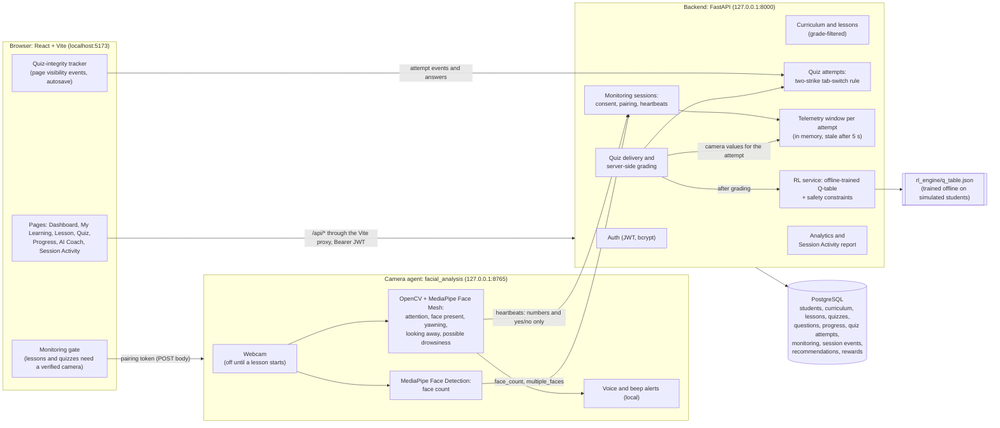

# Aegis architecture

Aegis runs as three local services plus a PostgreSQL database, all on the
student's own computer. The webcam is used only by the local camera agent,
and only numbers and yes/no signals leave the agent; images and video are
never stored or sent.

## Request flow for one monitored quiz

1. **Consent.** The student gives camera consent. Students under 18 also
   confirm parent/guardian and school authorisation (`monitoring_consents`).
2. **Session and pairing token.** The browser creates a monitoring session
   for a lesson the student may open. The backend returns a single-use
   **pairing token**, stored only as a SHA-256 hash.
3. **Agent pairing.** The browser hands the token to the local agent. The
   agent claims the session and receives an **agent token**, which is valid
   only for heartbeats on that session.
4. **Heartbeats.** The agent opens the webcam and sends about one heartbeat
   per second. Each has a sequence number, and replays are refused.
   Measurements more than a few seconds old are treated as stale and not
   counted.
5. **Verified state.** Lessons and quizzes unlock only while the backend
   reports the session as *verified* (camera on, face found and stable,
   fresh data). They pause otherwise.
6. **Protected attempt.** Starting a quiz creates a server-side attempt
   (`quiz_attempts`). Answers are autosaved, the browser reports when the
   quiz page is hidden or shown, and the **server** applies the two-strike
   tab-switch rule ([SESSION_INTEGRITY.md](SESSION_INTEGRITY.md)). Leaving
   the quiz or breaking the rule ends the attempt without grading.
7. **Submit and grade.** The student submits the answers with the attempt
   and monitoring session ids. The server grades them against the stored
   answer key; correct answers and explanations are revealed only in the
   review after submission.
8. **Camera values.** The camera values stored with the attempt are the
   averages of the heartbeats received during it, taken from the server's
   telemetry window. Values sent by the browser are ignored. With no valid
   reading they are stored as `NULL`, never as low attention.
9. **Recommendation.** The attempt is the observed outcome of the previous
   recommendation, so a reward row is written. A new recommendation is then
   chosen:
   - the safety constraints first remove unsuitable actions (for example,
     moving on before passing);
   - the offline-trained Q-table then picks the highest-valued remaining
     action.

   No recommendation is made without valid camera telemetry.
10. **Analytics.** Dashboard, Progress, AI Coach and Session Activity read
    these records through `GET /analytics/summary`, `GET /recommendations`
    and `GET /integrity/report`. Each student sees only their own records.

## Trust boundaries

| Boundary | Protection |
|---|---|
| Browser → API | JWT bearer token (30 minutes by default); every student-data route checks ownership; teacher/admin roles for lesson management and attempt corrections |
| Other websites → API | No CORS headers. The frontend reaches the API through Vite's same-origin `/api` proxy |
| Other websites → camera agent | The agent listens on 127.0.0.1 only. It checks the `Host` header and the allowed `Origin`, and requires a custom `X-Aegis-Client` header |
| Agent → API | The pairing token is single use and expires after 2 minutes. The agent token works only for heartbeats on its own session and is revoked when the session ends |
| Network → dev server | Vite binds to 127.0.0.1 (opt in to LAN exposure with `AEGIS_DEV_HOST`) |
| Quiz integrity | Answers are never sent before submission. Grading is server-side. Students cannot edit attempts. Tab-switch reports are deduplicated and judged by the server; terminated attempts are never graded |

## Code map

| Folder | Contents |
|---|---|
| `backend/app/routers/` | HTTP endpoints: auth, curriculum, lessons, quiz and attempts, progress, monitoring, telemetry (`integration.py`), recommendations (`rl.py`), analytics, integrity report |
| `backend/app/services/` | Business logic: grading, quiz attempts and the tab-switch rule, curriculum access, monitoring, telemetry window, recommendations, analytics, integrity report |
| `backend/app/models/` | SQLAlchemy models (tables listed in the [README](../README.md#database-schema)) |
| `backend/migrations/` | Alembic migrations `0001`–`0008` |
| `backend/curriculum/` | Curriculum JSON (Grades 6–10 × 4 subjects), loader, validator and idempotent importer |
| `backend/scripts/` | Curriculum import and checks, role assignment, recommendation outcome report |
| `rl_engine/` | State encoding, 11 actions, safety constraints, simulator, offline Q-learning trainer, evaluation, trained `q_table.json` |
| `facial_analysis/` | Camera agent: local HTTP server, monitoring controller, detectors, face counter, voice alerts, Windows camera-privacy check |
| `frontend/src/` | React pages, layout, shared UI components (`components/ui/`), monitoring gate, quiz-integrity tracker, API clients (`services/`) |

More detail:
- [API_REFERENCE.md](API_REFERENCE.md): every endpoint.
- [RL_ENGINE.md](RL_ENGINE.md): state, actions, rewards, training and evaluation.
- [SESSION_INTEGRITY.md](SESSION_INTEGRITY.md): the tab-switch rule, multiple-face detection and the activity report.
- [ANALYTICS.md](ANALYTICS.md): how every dashboard metric is calculated.
- [facial_analysis/README.md](../facial_analysis/README.md): the camera agent.
