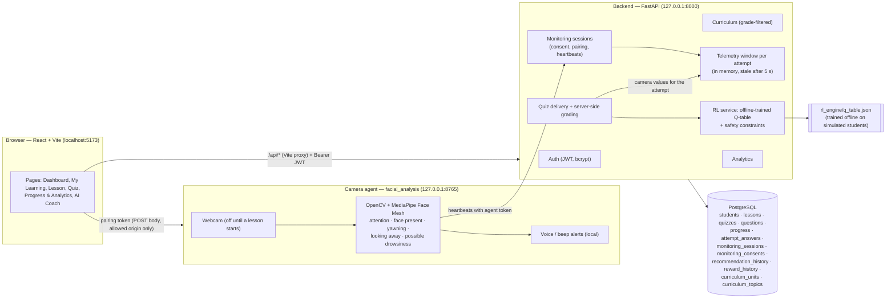

# Aegis architecture

Aegis runs as three local services plus PostgreSQL. Everything runs on the
student's own Windows computer. The webcam is used only by the local camera
agent, and only numbers and yes/no signals leave it.

## Request flow for one monitored quiz

1. **Consent.** The student gives camera consent. Minors also confirm
   parent/guardian and school authorisation (`monitoring_consents`).
2. **Session and pairing token.** The browser creates a monitoring session
   for a lesson it may open. The backend returns a single-use **pairing
   token**, stored only as a SHA-256 hash.
3. **Agent pairing.** The browser hands the token to the local agent. The
   agent claims the session and receives an **agent token**, used only for
   heartbeats.
4. **Heartbeats.** The agent opens the webcam and sends about one heartbeat
   per second. Each has a sequence number, and replays are refused.
   Measurements that are more than a few seconds old are marked stale and
   not counted.
5. **Verified state.** Lessons and quizzes unlock only while the backend
   reports the session as *verified* (camera on, face found and stable,
   fresh data). They pause otherwise.
6. **Submit and grade.** The student submits answers with the session id.
   The server grades them against the stored answer key. Answers and
   explanations are only revealed in the review after submission.
7. **Camera values.** The camera values for the attempt are the average of
   the heartbeats received during it, taken from the server's telemetry
   window. Values sent by the browser are ignored. With no valid reading
   they are stored as `NULL`, never as low attention.
8. **Recommendation.** The attempt is the observed outcome of the previous
   recommendation, so a reward row is written. A new recommendation is
   then chosen:
   - the safety constraints first remove unsuitable actions (for example,
     moving on before passing);
   - the offline-trained Q-table then picks the highest-valued remaining
     action.

   No recommendation is made without valid camera telemetry.
9. **Analytics.** Dashboard, Progress & Analytics and AI Coach read these
   records through `GET /analytics/summary` and `GET /recommendations`. Each
   student only sees their own records.

## Trust boundaries

| Boundary | Protection |
|---|---|
| Browser → API | JWT bearer token (30 min); every student-data route checks ownership; teacher/admin roles for curriculum and attempt corrections |
| Other websites → API | No CORS headers. The frontend reaches the API through Vite's same-origin `/api` proxy |
| Other websites → camera agent | Agent listens on 127.0.0.1 only. It checks the `Host` header and allowed `Origin`, and requires a custom `X-Aegis-Client` header |
| Agent → API | Pairing token is single use and short-lived. Agent token works only for heartbeats on its own session and is revoked when the session ends |
| Network → dev server | Vite binds to 127.0.0.1 (opt in to LAN exposure with `AEGIS_DEV_HOST`) |
| Quiz integrity | Answers never sent before submission. Server-side grading. Students cannot edit attempts |

## Code map

| Folder | Contents |
|---|---|
| `backend/app/routers/` | HTTP endpoints (auth, curriculum, lesson, quiz, progress, monitoring, rl, analytics) |
| `backend/app/services/` | Business logic: grading, curriculum access, monitoring, telemetry window, recommendations, analytics |
| `backend/app/models/` | SQLAlchemy models; schema managed by Alembic (`backend/migrations/`) |
| `backend/curriculum/` | Curriculum JSON (Grades 6–10 × 4 subjects), validator and idempotent importer |
| `rl_engine/` | State encoding, 11 actions, safety constraints, simulator, offline Q-learning trainer, trained `q_table.json` |
| `facial_analysis/` | Camera agent: HTTP server, monitoring controller, detectors, voice alerts |
| `frontend/src/` | React pages, monitoring gate, API clients, analytics helpers |

More detail:
- [RL_ENGINE.md](RL_ENGINE.md): state, actions, rewards, training and evaluation.
- [ANALYTICS.md](ANALYTICS.md): every dashboard metric.
- [TEAM_GUIDE.md](../TEAM_GUIDE.md#-api-contracts): the full API reference.
